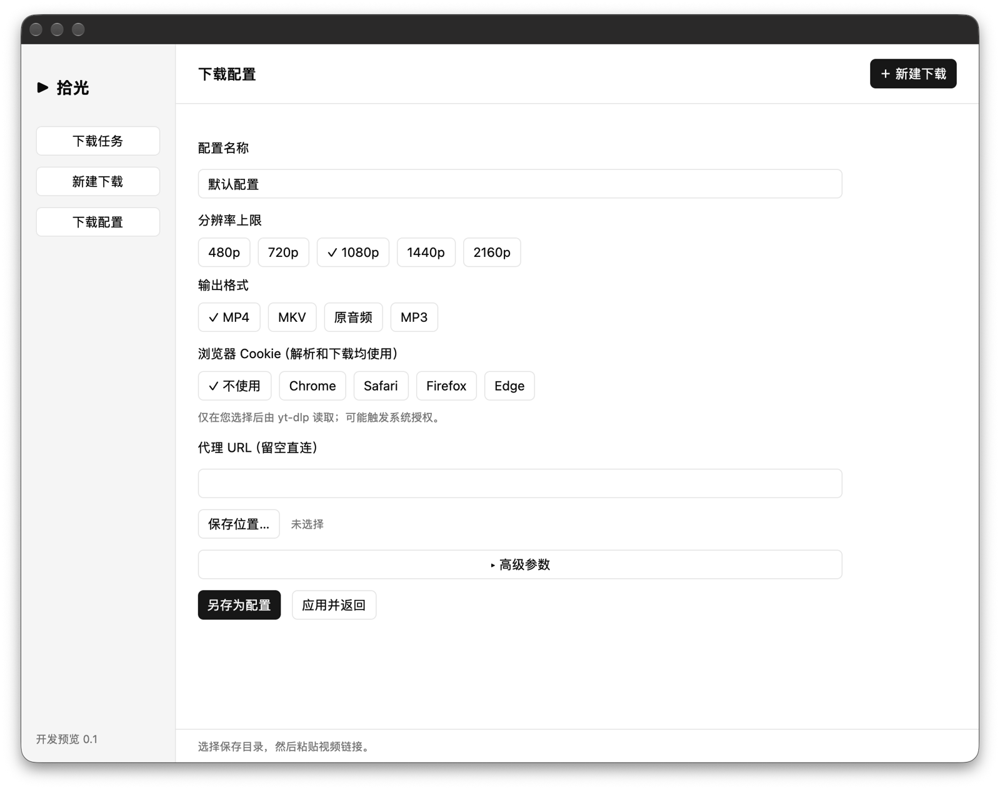

<div align="center">

# Shiguang · 拾光

**Start with a link. Keep what matters.**

A native YouTube downloader built with Rust and GPUI Kit.<br>
Video inspection, reusable preferences, and command review—in one local desktop workflow.

[](https://www.rust-lang.org/)
[](https://gpui-kit.com/)


[简体中文](<README.md>) · **English**

[Highlights](#highlights) · [Screenshots](#screenshots) · [Getting started](#getting-started) · [Contributing](#contributing)

</div>

<p align="center">
  
</p>

> [!IMPORTANT]
> **Developer preview, not a stable release.** The current focus is running from source on macOS. Real-site downloads and the complete native interaction flow have not completed acceptance testing. Parallel tasks and history are being integrated and are not advertised as verified features. Screenshots show existing native windows, may differ from ongoing development, and do not demonstrate a successful download.

## Why Shiguang?

Powerful command-line tools deserve a more approachable everyday workflow. Shiguang brings common [yt-dlp](https://github.com/yt-dlp/yt-dlp) choices into a desktop interface without hiding what is about to run.

- **Focus on the content.** Choose format, resolution, and destination without rebuilding a command every time.
- **Review before you run.** Inspect the video, check a structured summary, and review a redacted command before confirming.
- **Keep your preferences.** Save local download profiles and switch between them for the next video.
- **Stay in control.** Use tools you install yourself. No silent component installation; browser cookies are off by default.

## Highlights

| Capability | Current design and implementation |
| --- | --- |
| 🖥️ Native desktop UI | Rust + GPUI Kit, with task, new-download, and preferences pages |
| 🔗 Link inspection | YouTube single-video and Shorts links; inspect metadata before confirming |
| 🎞️ Video and audio | MP4, MKV, original-format audio, and MP3; resolution caps or best available |
| 🎛️ Reusable profiles | Save-as and switch local profiles, including destination, proxy, format, and quality |
| 🔎 Preflight review | Structured summary and an expandable, copyable, quoted and redacted command preview |
| 🍪 Explicit authentication | Optional Chrome / Safari / Firefox / Edge selection and a specific browser profile; disabled by default |
| 🧰 Restricted advanced options | Allowlisted subtitle, language/format, rate-limit, retry, and fragment-concurrency options |
| 🛑 Task controls | Progress, cancellation with process cleanup, and Finder reveal after successful completion |
| 🛡️ Process and file boundaries | Structured argv, no shell execution; plugins and remote components disabled; final output path checks |

> Implemented code does not mean every site, format, or browser combination has been tested. Availability depends on the source, network, yt-dlp, browser permissions, and local dependencies.

### Pick the output that fits

| Output | Best for | Important details |
| --- | --- | --- |
| **MP4** | Common player compatibility | H.264 / AAC only; ≤1080p by default. Fails if no matching format exists, without implicit video transcoding |
| **MKV** | Broader source codec choices | Still constrained by actual source formats and the selected height cap |
| **Original audio** | Keeping the source audio format | Does not intentionally convert to MP3; not a byte-for-byte original-file guarantee |
| **MP3** | A common audio format | Explicit FFmpeg conversion, not a lossless guarantee |

“Best available” removes the height cap. It **does not bypass codec restrictions or guarantee 4K**.

## Screenshots

### Tasks · A clear starting point


### Preferences · Make your defaults reusable


*Real macOS developer-preview screenshots. The interface is currently primarily Chinese; bilingual documentation does not imply an English UI is available. The preferences capture predates later additions such as “best available” and the specific browser-profile input.*

## Getting started

### 1. Prepare your environment

This preview is for developers willing to build from source. This document does not promise stable installers, signed builds, or notarized releases.

- **macOS**: the primary development target; no verified minimum OS version is declared.
- **Rust / Cargo**: a toolchain supporting Rust 2024 edition (at least Rust 1.85 at the language level; dependencies may need newer versions). Latest stable is recommended.
- **Xcode development tools**: native builds need Apple's toolchain. SDK requirements depend on GPUI Kit and the build environment.
- **yt-dlp**: video inspection and downloads.
- **FFmpeg / ffprobe**: install together for merging/conversion and tool availability checks. ffprobe is not currently used for independent media-integrity verification.
- **Deno**: recommended for JavaScript challenges. Its presence alone does not guarantee challenge support.

If you already use [Homebrew](https://brew.sh/), you can install the external tools yourself:

```sh
# Explicit user installation; the application does not run this for you
brew install yt-dlp ffmpeg deno
```

Check that the tools are visible in the launching terminal's `PATH`:

```sh
rustc --version
cargo --version
yt-dlp --version
ffmpeg -version
ffprobe -version
deno --version
```

### 2. Run from source

After obtaining the source, run from the **repository root** containing this README and the Cargo workspace manifest. There is no additional `code` subdirectory to enter when this directory is published on its own.

```sh
cargo run --locked -p youtube-desktop
```

The first build downloads Rust dependencies. Time depends on your machine and network. The development branch may contain work in progress; report the commit and full build error if it fails rather than treating the preview as a stable release.

Optional: open preferences directly.

```sh
cargo run --locked -p youtube-desktop -- --preferences
```

### 3. Start a download

1. Open **新建下载** (New download), choose a saved profile, or edit preferences.
2. Choose a destination outside the repository and paste a YouTube link you are authorized to download.
3. Select **解析链接** (Inspect link) and review the video information.
4. Check format, quality, and the command summary, then confirm.
5. Follow progress, cancel when needed, or reveal the output in Finder after success.

## Privacy and safety boundaries

- **Local desktop workflow, not offline downloading.** Inspection and downloads contact YouTube and related services. This is not an anonymity guarantee.
- **Cookies are opt-in.** yt-dlp reads the selected browser only after explicit selection and may trigger macOS authorization. Profiles store browser selection, not cookie contents; authentication data can still be used at runtime.
- **Proxy credentials are not persisted.** Authenticated proxy settings are rejected when saving. Inspect logs, URLs, and commands yourself before sharing them.
- **No arbitrary execution options.** Advanced options are allowlisted. Execution hooks, plugin/config loading, and output-path/progress-protocol overrides are rejected.
- **No automatic component installation.** The application uses local tools and disables yt-dlp plugins and remote EJS components. Some JavaScript challenges may therefore be unsupported.
- **Not an OS sandbox.** External tools run with the current user's permissions. Final output checks validate file/path boundaries, not media completeness or correctness.

## Current scope and next steps

**Existing foundations:** native UI, inspection/download engine, local profiles, command preview, cancellation, and offline tests.

**Still needs validation:** real-site end-to-end downloads, complete native interactions, browser compatibility, and SDK/OS compatibility.

**In development / future directions** (not release commitments):

- [ ] End-to-end integration, testing, and interaction acceptance for parallel tasks and history
- [ ] Queue scheduling, task persistence, and restart recovery
- [ ] Fuller format selection and profile update/delete management
- [ ] Playlist and other batch workflows
- [ ] Installers, signing/notarization, and cross-platform release validation

## Development and tests

```sh
cargo check --locked --workspace
cargo test --locked -p youtube-engine
```

Engine tests use local fake tools to exercise protocols, cancellation, resource limits, and file safety. **They do not contact websites or prove that real YouTube downloads succeed.**

```text
.
├── Cargo.toml           # Rust workspace
├── Cargo.lock           # Locked dependencies
├── crates/
│   ├── desktop/         # GPUI Kit UI, state, background bridge, local settings
│   └── engine/          # Tool discovery, plans, process supervision, output checks
└── docs/
    ├── DEVELOPMENT.md   # Implementation notes and maintenance conventions
    └── images/          # Real UI screenshots distributed with the repository
```

See the [development guide](<docs/DEVELOPMENT.md>) for configuration details and module navigation (currently in Chinese).

## FAQ

**Why didn't “best available” select the highest resolution?**<br>
MP4 still requires H.264 / AAC. Higher resolutions may not exist with those codecs. Try MKV for broader codec choices, but a particular resolution is never guaranteed.

**Why does inspection fail even with Deno installed?**<br>
Site policies, yt-dlp versions, authentication, and locally available challenge components all matter. Remote component downloads are disabled; healthy tools do not prove site availability.

**Why can't I paste arbitrary CLI options?**<br>
Shiguang is not an unrestricted yt-dlp CLI editor. Use allowlisted options with one argv token per line: for example, `--limit-rate` and `2M` on separate lines.

**Where are profiles stored?**<br>
On macOS: `~/Library/Application Support/Shiguang/profiles.json`. A browser profile can be `Default`, `Profile 1`, or a Firefox profile directory. Leave it blank for yt-dlp's default selection. Compound `:`, `+`, and `#` syntax is rejected.

## Contributing

Help make Shiguang a more reliable, approachable native tool:

- **Report bugs:** include macOS version, commit, tool versions, reproduction steps, and redacted logs.
- **Improve the experience:** suggest workflow, accessibility, wording, and interface improvements.
- **Contribute code:** discuss large changes first, keep UI and engine responsibilities separate, and add offline tests for process/protocol/file boundaries.
- **Improve documentation:** correct translations and contribute real screenshots without personal information.

If this direction resonates with you, consider giving the published repository a **Star**—and bring your feedback along.

## Acknowledgements

[Rust](https://www.rust-lang.org/) · [GPUI Kit](https://gpui-kit.com/) · [yt-dlp](https://github.com/yt-dlp/yt-dlp) · [FFmpeg](https://ffmpeg.org/) · [Deno](https://deno.com/)

## License and responsible use

**No LICENSE file is currently included. The maintainer has not yet selected a project license.** Public source availability does not automatically grant open-source rights to use, modify, or redistribute it. Add a license and required third-party notices before a formal open-source release. Third-party projects remain subject to their own licenses.

Download only content you own, have permission to download, or are legally entitled to obtain. Follow applicable laws and platform terms. This project is not affiliated with, endorsed by, or an official partner of YouTube / Google.
