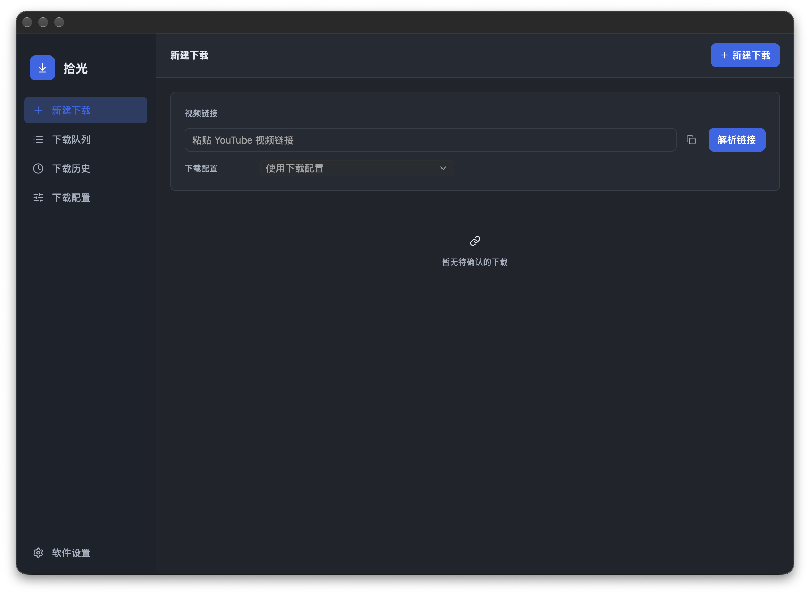

<div align="center">

# YTDer

**A focused desktop workflow for yt-dlp.**

Native macOS UI built with Rust and GPUI Kit. Paste a media link, inspect it, choose a profile, and download with a clear command preview.

[](https://www.rust-lang.org/)
[](https://gpui-kit.com/)


**English** · [简体中文](<README.zh.md>)

[Highlights](#highlights) · [Screenshots](#screenshots) · [Quick start](#quick-start) · [Development](#development)

</div>

<p align="center">
  
</p>

## Highlights

- **Fast link-to-download flow** — paste a public HTTP(S) media URL, inspect metadata, and start from one focused workspace.
- **Reusable profiles** — save format, quality, destination, proxy, browser profile, and naming preferences.
- **Clear preflight review** — inspect media details, redacted command arguments, output format, and destination before execution.
- **Video and audio modes** — MP4, MKV, original audio, and MP3 with best-available or capped resolution.
- **Real task controls** — progress, cancellation, queue recovery, history, pagination, sorting, and selectable columns.
- **Local-first tooling** — explicit yt-dlp, FFmpeg, ffprobe, and optional Deno paths with managed yt-dlp versions.
- **Native macOS experience** — quiet sidebar navigation, light/dark themes, English/简体中文 catalog, and Finder reveal.

## Screenshots

### New download


### Download profiles


### Software settings


## Quick start

### Requirements

- macOS on Apple Silicon
- Rust and Cargo
- yt-dlp
- FFmpeg and ffprobe
- Deno for sites that need a local JavaScript runtime

With Homebrew:

```sh
brew install yt-dlp ffmpeg deno
```

### Run from source

```sh
cargo run --locked -p youtube-desktop
```

Open a specific page for local layout checks:

```sh
cargo run --locked -p youtube-desktop -- --settings
cargo run --locked -p youtube-desktop -- --history
cargo run --locked -p youtube-desktop -- --preferences
```

### Build a self-use macOS app

```sh
./scripts/package-macos.sh
```

The script creates an unsigned `dist/macos/YTDer.app`. If the local macOS image tool is available, it also creates a DMG; otherwise it creates a ZIP fallback beside the app.

## Workflow

1. Open **New download**.
2. Paste a public media URL and choose a saved profile.
3. Inspect the media information.
4. Adjust the current task options if needed.
5. Review the command summary and add the task to the queue.
6. Track progress, cancel when needed, and revisit completed items in History.

## Project structure

```text
.
├── Cargo.toml
├── crates/
│   ├── desktop/       # GPUI Kit UI, state, history, profiles, and bridge
│   └── engine/        # URL handling, plans, process supervision, and artifacts
├── docs/              # Development and packaging notes
└── scripts/           # Local developer utilities
```

## Development

```sh
cargo check --locked --workspace
cargo test --locked --workspace
cargo build --locked --release -p youtube-desktop
```

The application keeps user data under `~/Library/Application Support/Shiguang/` for compatibility with existing profiles and history.

See [DEVELOPMENT.md](<docs/DEVELOPMENT.md>) and [macOS app bundle plan](<docs/MACOS-APP-BUNDLE-PLAN.md>) for implementation details.

## License

A project license has not been selected yet. Third-party projects remain subject to their own licenses.
