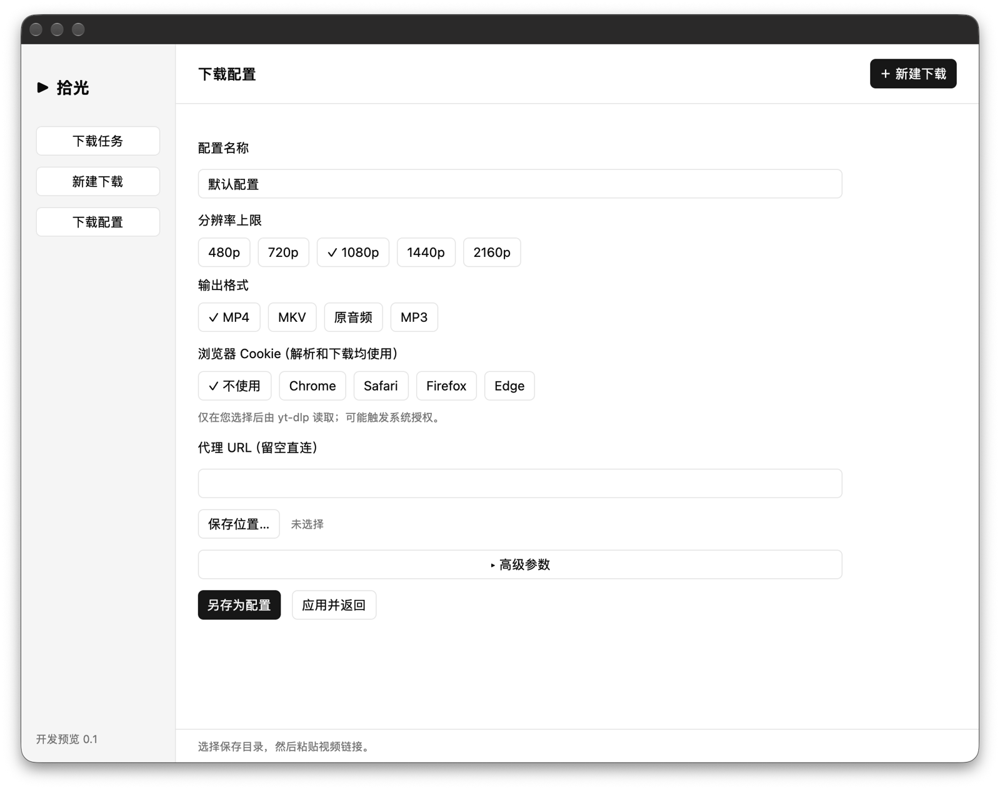

<div align="center">

# YTDer

**从一个链接开始，留住值得收藏的内容。**

基于 Rust 与 GPUI Kit 的原生 yt-dlp 桌面应用。<br>
把视频解析、下载配置和命令确认，放进一个清晰的本地工作流。

[](https://www.rust-lang.org/)
[](https://gpui-kit.com/)


**简体中文** · [English](<README.en.md>)

[功能亮点](#功能亮点) · [界面预览](#界面预览) · [快速开始](#快速开始) · [参与贡献](#参与贡献)

</div>

<p align="center">
  
</p>

> [!IMPORTANT]
> **这是开发预览，不是稳定发行版。** 当前以 macOS 源码运行体验为主；真实站点下载与完整原生交互尚未完成验收。并行任务与历史记录正在开发接线中，不作为已验证能力宣传。截图来自已有原生窗口，可能与最新开发中的界面不同；不代表成功下载证明。

## 为什么是 YTDer？

命令行工具足够强大，日常下载也可以更直观。YTDer希望保留 [yt-dlp](https://github.com/yt-dlp/yt-dlp) 的能力，同时把常用选择变得清晰、可复用、可检查。

- **把注意力留给内容。** 用图形界面选择格式、分辨率与保存目录，而不是每次重写一串参数。
- **在开始前看清楚。** 先解析，再查看配置摘要与经脱敏的命令，确认后才执行下载。
- **让常用习惯留下来。** 将下载偏好另存为本地配置，下次直接切换使用。
- **尊重本机工具与用户选择。** 调用你已安装的工具，不静默安装下载组件；浏览器 Cookie 默认关闭。

## 功能亮点

| 能力 | 当前设计与实现 |
| --- | --- |
| 🖥️ 原生桌面界面 | Rust + GPUI Kit；任务、新建下载与配置页面 |
| 🔗 链接解析 | 面向 YouTube 单视频与 Shorts，先解析视频信息，再确认下载 |
| 🎞️ 视频与音频 | MP4、MKV、原始音频、MP3；支持分辨率上限或“最佳可用” |
| 🎛️ 可复用配置 | 本地另存与切换配置；保存目录、代理、格式和质量偏好 |
| 🔎 执行前确认 | 结构化配置摘要；可展开、复制经过引用和脱敏的命令预览 |
| 🍪 显式认证选项 | 可选 Chrome / Safari / Firefox / Edge 及具体浏览器 Profile；默认不读取 |
| 🧰 有限高级参数 | 字幕、字幕语言/格式、限速、重试次数、分片并发等白名单参数 |
| 🛑 任务控制 | 下载进度、取消与进程收尾；成功完成后可在 Finder 中定位文件 |
| 🛡️ 文件与进程边界 | 结构化 argv 执行，不调用 shell；禁用插件及远程组件，校验最终产物 |

> “已有实现”不等于“所有站点、格式和浏览器组合均已实测”。可用性取决于源视频、网络、yt-dlp、浏览器权限及本地依赖。

### 选择适合你的输出

| 输出 | 适合什么场景 | 需要知道 |
| --- | --- | --- |
| **MP4** | 优先考虑常见播放器兼容性 | 限 H.264 / AAC，默认 ≤1080p；无匹配格式时失败，不隐式转码 |
| **MKV** | 希望保留更多源编码选择 | 仍受源视频实际可用格式与所选高度上限限制 |
| **原始音频** | 希望保留源音频格式 | 不主动转码为 MP3；不承诺逐字节原始文件 |
| **MP3** | 需要常用音频格式 | 显式调用 FFmpeg 转换，非无损承诺 |

“最佳可用”表示不设高度上限，**不表示绕过编码限制或保证 4K**。

## 界面预览

### 任务页 · 清晰的开始


### 下载配置 · 把偏好变成习惯


*以上为 macOS 原生开发预览截图，界面目前以中文为主；中英双语 README 不代表应用已经具备英文界面。配置截图早于“最佳可用”与具体浏览器 Profile 输入等后续调整。*

## 快速开始

### 1. 准备环境

当前面向愿意从源码运行的开发者；尚不提供此文档承诺的稳定安装包、签名或公证发行。

- **macOS**：当前主要开发目标，未声明经过验证的最低系统版本。
- **Rust / Cargo**：支持 Rust 2024 edition 的工具链（语言层面至少 Rust 1.85；依赖可能要求更新版本，建议使用最新 stable）。
- **Xcode 开发工具**：原生构建需要 Apple 工具链；具体 SDK 需求以 GPUI Kit 和构建错误为准。
- **yt-dlp**：视频解析与下载。
- **FFmpeg / ffprobe**：建议一起安装；FFmpeg 用于合并/转换，ffprobe 当前用于工具发现和健康检查，不代表独立媒体完整性验证。
- **Deno**：建议安装，用于可能遇到的 JavaScript 挑战；安装本身不保证挑战可解。

如果你已使用 [Homebrew](https://brew.sh/)，可自行运行：

```sh
# 由你主动安装；应用不会代为执行此命令
brew install yt-dlp ffmpeg deno
```

确保工具在启动应用的终端 `PATH` 中可找到：

```sh
rustc --version
cargo --version
yt-dlp --version
ffmpeg -version
ffprobe -version
deno --version
```

### 2. 从源码运行

获取源码后，在包含本 README 与 Cargo workspace 清单的**仓库根目录**运行，无需再进入名为 code 的子目录：

```sh
cargo run --locked -p youtube-desktop
```

首次构建会下载 Rust 依赖，耗时取决于网络和机器配置。当前开发分支可能存在进行中的变更；如果构建失败，请附上提交版本与完整错误信息反馈，不要将预览视为稳定发行。

可选：直接进入配置页面。

```sh
cargo run --locked -p youtube-desktop -- --preferences
```

### 3. 开始一次下载

1. 打开 **新建下载**，选择已有配置或编辑下载偏好。
2. 选择仓库外的保存目录，粘贴你有权下载的 YouTube 视频链接。
3. 点击 **解析链接**，检查视频信息。
4. 检查格式、质量和命令摘要，再确认下载。
5. 观察进度；需要时取消，成功后可在 Finder 中定位文件。

## 隐私与安全边界

- **本地桌面工作流**：解析与下载仍需要访问 YouTube 等相关网络服务，不是离线下载工具，也不承诺匿名性。
- **Cookie 默认关闭**：仅在明确选择浏览器后交给 yt-dlp 读取，可能触发 macOS 授权。配置文件保存浏览器选择，而不是 Cookie 内容；这不代表运行时没有认证数据。
- **代理凭据不落盘**：含认证信息的代理配置拒绝持久化。分享日志、链接和命令前仍应自行检查敏感信息。
- **拒绝任意执行参数**：高级参数采用白名单，执行钩子、插件/配置加载、输出路径与进度协议覆盖等选项会被拒绝。
- **不自动补装组件**：使用本机工具，禁用 yt-dlp 插件与远程 EJS 组件；可能因此无法处理部分 JavaScript 挑战。
- **不是 OS 沙箱**：外部工具以当前用户权限运行。产物检查验证路径及文件边界，不证明媒体完整、可播放或内容正确。

## 当前边界与后续方向

**已有基础**：原生 UI、解析/下载引擎、本地配置、命令预览、取消控制与离线测试。

**仍需验证**：真实站点端到端下载、完整原生交互、不同浏览器读取、SDK/系统版本兼容性。

**开发中 / 后续方向**（不是发行承诺）：

- [ ] 并行任务与历史记录的端到端接线、测试和交互验收
- [ ] 队列调度、任务持久化与重启恢复
- [ ] 更完整的格式选择与配置更新/删除管理
- [ ] 播放列表等批量场景
- [ ] 安装包、签名/公证与跨平台发行验证

## 开发与测试

```sh
cargo check --locked --workspace
cargo test --locked -p youtube-engine
```

引擎测试使用本地假工具覆盖协议、取消、限额与文件安全等行为，**不会访问站点，也不能证明真实 YouTube 下载成功**。

```text
.
├── Cargo.toml           # Rust workspace
├── Cargo.lock           # 锁定依赖
├── crates/
│   ├── desktop/         # GPUI Kit 界面、状态、后台桥接与本地配置
│   └── engine/          # 工具发现、下载计划、进程监督与产物校验
└── docs/
    ├── DEVELOPMENT.md   # 开发细节与维护约定
    └── images/          # 随仓库分发的真实界面截图
```

更多配置说明、安全限制与模块导航见 [开发指南](<docs/DEVELOPMENT.md>)。

## 常见问题

**为什么“最佳可用”没有下载最高分辨率？**<br>
MP4 仍限制 H.264 / AAC。源视频不一定提供对应编码的高分辨率格式；可尝试 MKV，但仍不保证具体画质可用。

**为什么已安装 Deno，解析还是失败？**<br>
站点策略、yt-dlp 版本、登录状态和本地挑战组件都会影响结果。应用禁用远程组件自动下载；工具健康检查不代表站点一定可用。

**为什么高级参数不能照搬命令行？**<br>
YTDer不是任意 yt-dlp CLI 编辑器。请使用白名单参数，每行一个 argv token，例如 `--limit-rate` 和 `2M` 分占两行。

**配置保存在哪里？**<br>
macOS 用户目录下的 `~/Library/Application Support/YTDer/profiles.json`。具体浏览器 Profile 可填写 `Default`、`Profile 1` 或 Firefox profile 目录，留空由 yt-dlp 选择；不接受 `:`、`+`、`#` 复合语法。

## 参与贡献

欢迎一起把YTDer打磨成更可靠、更好用的原生工具：

- **报告问题**：提供 macOS 版本、提交版本、本地工具版本、复现步骤和脱敏日志。
- **改进体验**：分享下载流程、可访问性、文案和界面方面的建议。
- **贡献代码**：大改动先讨论；保持 UI 与引擎分离，为协议、进程及文件边界补充离线测试。
- **完善文档**：修正中英文说明，提供去除个人信息的真实截图。

如果这个方向对你有帮助，欢迎在发布后的仓库点亮 **Star**，也欢迎带着具体反馈一起参与。

## 致谢

- [Rust](https://www.rust-lang.org/) — 语言与工具链。
- [GPUI Kit](https://gpui-kit.com/) — 原生界面组件。
- [yt-dlp](https://github.com/yt-dlp/yt-dlp) — 媒体解析与下载。
- [FFmpeg](https://ffmpeg.org/) — 媒体处理与检查。
- [Deno](https://deno.com/) — 本地 JavaScript 运行时。

## 许可与使用须知

**当前仓库尚未包含 LICENSE 文件，开源许可证待维护者确定。** 公开源码不等于自动授予开源使用、修改和再分发许可；正式开源前请补充许可证及必要的第三方声明。第三方项目遵循各自许可证。

仅下载你拥有版权、获得授权或依法有权获取的内容，遵守适用法律与平台条款。本项目与 YouTube / Google 无隶属、背书或官方合作关系。
