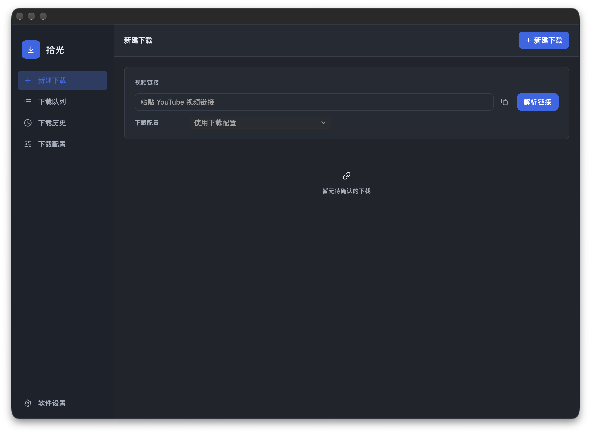

<div align="center">

# YTDer

**一个更专注的 yt-dlp 桌面工作流。**

基于 Rust 与 GPUI Kit 的原生 macOS 界面：粘贴媒体链接、解析信息、选择配置、预览命令，然后开始下载。

[](https://www.rust-lang.org/)
[](https://gpui-kit.com/)


[English](<README.md>) · **简体中文**

[功能亮点](#功能亮点) · [界面预览](#界面预览) · [快速开始](#快速开始) · [开发](#开发)

</div>

<p align="center">
  
</p>

## 功能亮点

- **从链接开始**：粘贴公共 HTTP(S) 媒体地址，解析信息后进入下载流程。
- **可复用下载配置**：保存格式、画质、目录、代理、浏览器 Profile 和命名模板。
- **下载前清晰确认**：查看媒体信息、脱敏命令参数、输出格式和保存位置。
- **视频与音频模式**：支持 MP4、MKV、原始音频和 MP3，以及最佳可用或指定分辨率。
- **任务与历史管理**：显示进度，支持取消、队列恢复、历史分页、排序和自定义列。
- **本地工具管理**：显式配置 yt-dlp、FFmpeg、ffprobe 和可选 Deno，并支持托管 yt-dlp 版本。
- **原生 macOS 体验**：清晰侧栏、浅色/深色主题、English/简体中文和 Finder 定位。

## 界面预览

### 新建下载


### 下载配置


### 软件设置


## 快速开始

### 环境

- Apple Silicon macOS
- Rust 与 Cargo
- yt-dlp
- FFmpeg 与 ffprobe
- 需要本地 JavaScript 运行时时可安装 Deno

使用 Homebrew：

```sh
brew install yt-dlp ffmpeg deno
```

### 从源码运行

```sh
cargo run --locked -p youtube-desktop
```

也可以直接打开指定页面：

```sh
cargo run --locked -p youtube-desktop -- --settings
cargo run --locked -p youtube-desktop -- --history
cargo run --locked -p youtube-desktop -- --preferences
```

### 构建自用 macOS 应用

```sh
./scripts/package-macos.sh
```

脚本会生成未签名的 `dist/macos/YTDer.app`。如果本机支持 macOS 镜像工具，还会生成 DMG；否则会在应用旁生成 ZIP 备用包。

## 使用流程

1. 打开 **新建下载**。
2. 粘贴媒体链接并选择下载配置。
3. 查看解析到的媒体信息。
4. 按需修改本次任务选项。
5. 查看命令摘要并加入下载队列。
6. 观察进度，必要时取消，并在下载历史中管理完成记录。

## 项目结构

```text
.
├── Cargo.toml
├── crates/
│   ├── desktop/       # GPUI Kit 界面、状态、历史、配置和桥接
│   └── engine/        # URL、命令计划、进程监督与产物校验
├── docs/              # 开发与打包说明
└── scripts/           # 本地开发脚本
```

## 开发

```sh
cargo check --locked --workspace
cargo test --locked --workspace
cargo build --locked --release -p youtube-desktop
```

为兼容已有配置和历史，用户数据仍保存在 `~/Library/Application Support/Shiguang/`。

详见 [开发指南](<docs/DEVELOPMENT.md>) 和 [macOS App 打包规划](<docs/MACOS-APP-BUNDLE-PLAN.md>)。

## 许可

项目许可证尚未确定；第三方项目遵循各自许可证。
